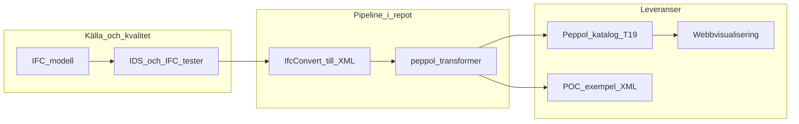

# BIM2BOM - Från digital modell till materiallista

## Vad är BIM2BOM?

BIM2BOM är ett projekt som skapar en obruten digital kedja från byggnadsmodeller (BIM) till materiallistor (BOM) för att effektivisera byggprocessen. Projektet utvecklar verktyg och standarder som gör det möjligt att automatiskt hämta materialdata direkt från digitala byggnadsmodeller och omvandla denna information till standardiserade format som kan användas i anbud, inköp och produktion.

I det här repositoriet finns både en **ände-till-ände-verktygskedja** (IFC → XML → Peppol) och ett **konceptbevis** med validerade **Peppol BIS Catalogue**-meddelanden som visar hur spårbarhets- och receptmönster kan uttryckas i XML.

## Informationsflöde (översikt)




## Varför behövs detta?

Idag används information i byggnadsmodeller huvudsakligen under projektering, men det finns liten koppling till faktiska inköp och budgetuppföljning under produktion. Detta leder till ineffektivitet, svårigheter med standardisering och utmaningar i att följa upp miljöpåverkan genom hela byggprocessen. BIM2BOM skapar en transparent och spårbar process där all information kommer från en källa – BIM-modellen.

## Vad finns i repositoriet?

Det här är ett **monorepo** med fristående delprojekt (ingen gemensam build-kedja). Översikt:


| Område                 | Innehåll                                                                                                                                                                                          |
| ---------------------- | ------------------------------------------------------------------------------------------------------------------------------------------------------------------------------------------------- |
| **Python-pipeline**    | `[ifc2peppol/](ifc2peppol/README.md)`, `[peppol-transformer/](peppol-transformer/README.md)`, `[IfcConvert/](IfcConvert/README.md)` — konvertering och transformation till Peppol-katalogstruktur |
| **Krav och tester**    | `[BEAst-ifctester/](BEAst-ifctester/README.md)`, `[BEAst-BIP-type-tester/](BEAst-BIP-type-tester/README.md)` — validering mot BEAst/IDS-relaterade krav och typbeteckningar                       |
| **Konceptbevis (XML)** | `[POC-Leverables/](POC-Leverables/README.md)` — nio validerade Peppol Catalogue-exempel, batchvalidering och [XML Message Reference](POC-Leverables/XML_MESSAGE_REFERENCE.md)                     |
| **End-to-end-test**    | `[test_workflow.py](test_workflow.py)`, dokumenterat i `[TEST_README.md](TEST_README.md)`                                                                                                         |
| **Webbappar**          | `[bimtobomsimulator/](bimtobomsimulator/README.md)` (port 5173), `[bim2bom-canvas-app/](bim2bom-canvas-app/README.md)` (5174), `[peppol-bip-explorer/](peppol-bip-explorer/README.md)` (5175)     |
| **Exempelmodell**      | `[models/](models/README.md)`                                                                                                                                                                     |


Projektet levererar i praktiken verktyg för att:

- **Validera BIM-modeller** mot BEAst Modelleringskrav så att rätt information finns med
- **Konvertera IFC** till XML för vidare bearbetning
- **Skapa och exemplifiera Peppol-kataloger** (BIS Catalogue 3.4, transaktion T19) för digital handel och uppföljning
- **Verifiera kataloger** — både i pipelinen och via PoC-validering

## Konceptbevis: Peppol-kataloger (`[POC-Leverables/](POC-Leverables/README.md)`)

Mappen innehåller **nio validerade** Peppol Catalogue XML-filer som demonstrerar hur recept och olika katalogtyper kan hanteras i BIM2BOM-kontext:

- **Use case 1 – väggtyper, prisförfrågan:** köparens förfrågan och säljarens specificationssvar utan recept (`UseCase1-WallTypes-PriceRequest/`).
- **Use case 2 – väggtyper, summerade mängder:** köparens summerade vägglista och säljarens detaljerade svar **med recept** (`UseCase2-WallTypes-SummedQuantities/`).
- **Use case 3 – unika väggar:** köparens förfrågan och två sälj-svar som jämför **spårbar katalog** (gemensamt **CDEGuid** kopplat till IFC `GlobalId`, barnrader med `**cac:ComponentRelatedItem`** mot förälderns `**CatalogueLineID**`) mot **standardkatalog** utan samma spårbarhet (`UseCase3-UniqueWalls-Quantities/`).
- **Manufacturing BOM:** spårbar respektive standardvariant för artikelstrukturer (`ManufacturingBOM/`).

Identifiering i exemplen följer mönster som beskrivs i [POC README](POC-Leverables/README.md): **BIP.TypeID** (köpare/säljare), **GTIN** där säljkataloger ska bära produktnivå-spårbarhet, och korrekt UBL-ordning på `cac:Item`.

**Validera alla PoC-filer** (extern Peppol-validator kräver nätverk; lokalt alternativ utan API):

```bash
cd POC-Leverables
python validate_all.py
python validate_all.py --local
```

Detaljer om taxonomi, mappstruktur och källvägg i IFC-modellen finns i `[POC-Leverables/README.md](POC-Leverables/README.md)`.

## Utveckling och testning

- **Hela kedjan (rekommenderat):** se `[TEST_README.md](TEST_README.md)`. Snabb körning utan IFC-konvertering i miljöer där `IfcConvert.exe` (Windows) eller Linux-binären `[IfcConvert/IfcConvert](IfcConvert/README.md)` hanteras separat:
  ```bash
  python test_workflow.py --skip-ifcconvert --keep-files
  ```
- **PoC-kataloger:** kommandona ovan i `[POC-Leverables/](POC-Leverables/)`.
- **BDD mot IFC:** från `[BEAst-BIP-type-tester/](BEAst-BIP-type-tester/README.md)`, med exempelmodell under `models/`:
  ```bash
  cd BEAst-BIP-type-tester
  python -m behave --define input=../models/A-40-V-000_BIM2BOM.ifc
  ```
- **Webbappar:** i respektive katalog, `npm install` och `npm run dev` (se tabellen i föregående avsnitt för portar). Använd `npm` enligt projektets lockfiler.

Python-beroenden är uppdelade per skriptmapp; se t.ex. `[peppol-transformer/scripts/requirements.txt](peppol-transformer/scripts/requirements.txt)` för pipeline-relaterade paket.

## Vem kan använda detta?

- **Byggherrar** får bättre kvalitetssäkring och mer exakta mängdavtagningar
- **Entreprenörer** får sömlös övergång från design till produktion med minskad risk för felbeställningar
- **Projektörer** får tydliga krav på vilken information som ska finnas i modellerna

## Tekniska komponenter

Projektet innehåller flera verktyg som arbetar tillsammans:

1. **BIM2BOM.ids** – Standard för vilken information som ska finnas i BIM-modeller, inklusive MMI-krav (Model Maturity Index)
2. **BEAst-ifctester** – Verktyg för att validera IFC-filer mot kraven
3. **BEAst-BIP-type-tester** – Verktyg för att testa typbeteckningar
4. **IfcConvert** – Konverterar IFC-filer till XML-format med MMI-filtrering (≥375)
5. **peppol-transformer** – Omvandlar XML till Peppol-kataloger med MMI-validering och kvalitetskontroll

### MMI-filtrering (Model Maturity Index)

För att säkerställa hög datakvalitet använder BIM2BOM MMI-filtrering på nivå 375 eller högre. Detta innebär att endast modellelement med tillräcklig informationsmognad inkluderas i materiallistor och Peppol-kataloger. MMI-skalan följer standardiserade nivåer från 100 (grundläggande information) till 500 (as-built dokumentation).

## Resultat

Genom BIM2BOM skapas en digitaliserad, standardiserad och automatiserad process från BIM till strukturerad inköpsinformation som följer principerna i SS-EN ISO 19650. I repositoriet är detta konkretiserat genom transformkedjan ovan, validerings- och testskript, samt **Peppol BIS Catalogue**-exempel som visar spårbara och icke-spårbara katalogmönster mot en gemensam referensmodell. Det bidrar till ökad transparens, bättre resursanvändning och minskade klimatutsläpp i byggprocessen — med öppen kod som kan itereras vidare i projekt och integrationer.